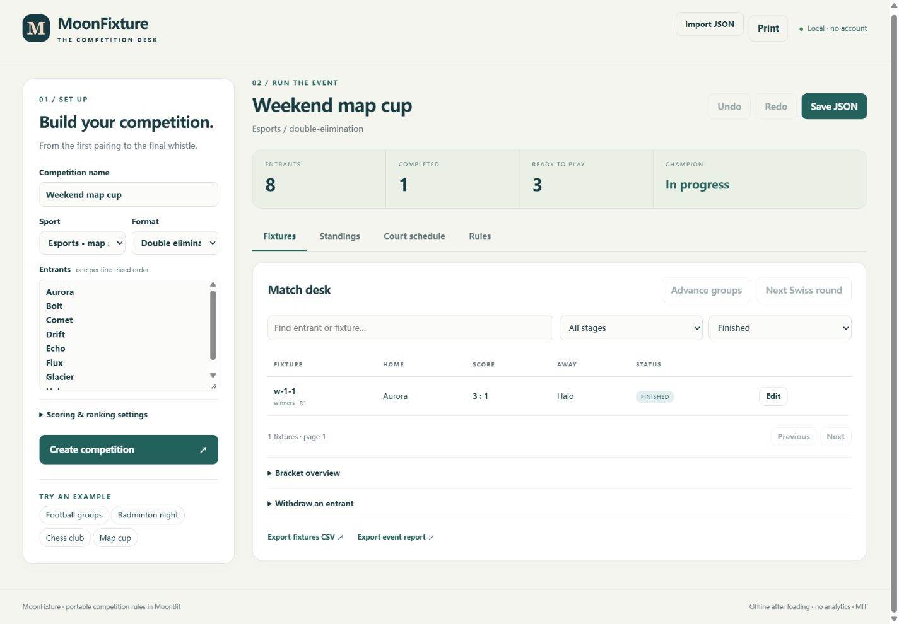

# MoonTourney

**A reusable MoonBit competition engine and a local web desk for clubs, campuses and community events.**

An eight-team football cup needs more than a draw: someone must generate group fixtures, apply the scoring policy, settle qualification ties, advance the correct entrants and update the bracket when an earlier result changes. MoonTourney connects those operations through one portable library.



## What works

- **Ten formats:** round robin, double round robin, single elimination, double elimination with a conditional grand-final reset, single- or double-leg groups followed by knockout, single- or double-leg league followed by knockout, Club Swiss, and a fixed-length Swiss stage followed by knockout.
- **Ten scoring profiles:** open score for organizer-defined activities, football, basketball, indoor volleyball, beach volleyball, badminton 21 points, badminton 15-point alternative, table tennis, chess and esports map series.
- Seeded brackets, automatic byes, optional third place, balanced group sizes, configurable qualification and best-of lengths.
- Terminal-score validation, set aggregates, football shootout decisions and canonical forfeits.
- Configurable rankings: points, wins, difference, scored, head-to-head mini-table, set/score ratios, Buchholz, Buchholz Cut-1, Sonneborn-Berger and explicit seed order.
- Dependent-result invalidation, withdrawals, 100-step session undo/redo and versioned JSON snapshots.
- Automatic suggested timetables with daily playing hours, court allocation, participant rest and dependency checks; CSV and Markdown exports.
- An English web interface with filters, bracket overview, standings explanations, JSON import/export, browser persistence and print layout.
- A season archive for Spring, Summer and later events: independent snapshots, one-click next-season setup, historical winners and participation, plus JSON / CSV export. Different seasons may use different sports and formats; scores are not mixed across incompatible rules.

### Format limits

| Format | Entrants | Behavior |
|---|---:|---|
| Round robin / double round robin | 2–128 | Every pair plays once / twice, reversed home and away |
| League → knockout / home-away league → knockout | 2–128 | Every pair plays once / twice; finish the table, then advance the top 2/4/8/… active entrants into a seeded bracket. Unresolved seeding or cutoff ties block advancement |
| Single elimination | 2–128 | Power-of-two seeded bracket with byes; optional third place |
| Double elimination | 2–128 | Two losses eliminate; lower-bracket champion can trigger a final reset |
| Groups → knockout | 2–16 groups, at least two entrants each | Snake distribution; qualification cutoff ties block advancement |
| Home/away groups → knockout | 2–16 groups, at least two entrants each | Each pair plays twice with reversed sides before qualification |
| Club Swiss | 2–64 | No repeat opponents, score proximity, soft side balance, at most one full-point bye |
| Swiss → knockout | 2–64; 1 to entrant count minus one Swiss rounds | Configured rounds, then top 2/4/8/… active entrants enter a seeded knockout; unresolved seeding and cutoff ties block advancement |

Presets implement **scoring subsets and disclosed organizer policies**, rather than complete federation regulations. Club Swiss is not FIDE Dutch pairing. Basketball does not implement the complete recursive Appendix D classification. Read [the rules catalog](docs/RULES.md) before selecting a profile.

## Run the web desk

Requirements: the [official MoonBit toolchain](https://www.moonbitlang.com/download/) (tested with `moon 0.1.20261012`) and Node.js 22 or later. No npm packages or external Mooncakes packages are required.

```sh
node scripts/build.mjs
node host/serve.mjs
```

Open **http://127.0.0.1:4173**. The development server only serves the built page on loopback. All event calculations and data storage run in your browser.

1. Select a sport and format, paste one entrant per line, and optionally name the season. Leave **Save this competition as a season** checked to archive it automatically.
2. Select **Generate competition & schedule**. The Fixtures view shows all currently knowable rounds, suggested times and courts. The Court schedule tab shows the timetable; change its daily hours or court count and select **Update timetable** if needed.
3. After each game, select **Score** beside that fixture and enter the real result. Completed scores appear in both views and standings update automatically. For set-based sports, enter scores such as `21-18, 19-21, 21-15`.
4. Completed group and league stages advance automatically when ranking ties are resolved. Swiss → knockout automatically generates the next pairing or playoff after each completed round. Open-ended Club Swiss uses **Next Swiss round** when the organizer is ready.
5. In **Season archive**, enter the next season name and select **Start next season** to reuse the format and entrants with empty scores. Edit the entrant list and select **Apply entrant list** before recording scores if teams changed. Export the full series JSON as a backup.

Actual results are never invented by the planner. Elimination opponents may be shown as winners of earlier fixtures; group/league playoffs and later Swiss pairings are generated only after the prerequisite results are known. Suggested times can change when results arrive, so export a timetable before publishing it as a fixed commitment.

The browser restores the latest event on reload. Undo history is held in memory and resets on reload. Export JSON for backups; storage can be cleared by browser settings. The web app contains no external assets, tracking or account service.

The season archive is separate from a single-event snapshot. Importing a series JSON restores its seasons; importing an event JSON opens one standalone event. Up to 32 seasons are supported. Participant history matches names exactly, so use consistent names across years. Cross-sport points are deliberately kept separate; the series overview records appearances and titles.

## CLI

```sh
node dist/moontourney.mjs create examples/badminton-cup.json event.json
node dist/moontourney.mjs record event.json examples/badminton-result.json updated.json
node dist/moontourney.mjs inspect updated.json
node dist/moontourney.mjs schedule updated.json examples/schedule.json schedule.csv
node dist/moontourney.mjs export updated.json report event-report.md
node dist/moontourney.mjs create examples/community-league-playoff.json league.json
node dist/moontourney.mjs season-new "Community 2026" seasons-empty.json
node dist/moontourney.mjs season-add seasons-empty.json league.json "Spring 2026" seasons-spring.json
node dist/moontourney.mjs season-clone seasons-spring.json season-1 "Summer 2026" seasons-summer.json
node dist/moontourney.mjs season-list seasons-summer.json
```

Output files must be new paths. Existing snapshots are never overwritten. Omit an output path to use stdout. See [CLI commands](docs/CLI.md) and the [JSON API](docs/API.md).

## Reuse the library

The root package is `moontourney/core`; the module is prepared locally and has **not yet been published to Mooncakes**. Integrations can use the workspace package or the built `dist/engine.mjs` JSON interface.

```moonbit
let participants = @core.participants_from_names(["Aurora", "Bolt", "Comet", "Drift"])
let rules = @core.preset("football")
let event = @core.create_tournament("Club cup", @core.SingleElimination, rules, participants)
let played = @core.record_result(event, @core.score_result("w-1-1", 2, 1))
let table = @core.standings(played)
```

These functions raise `FixtureError` for invalid input. See [library architecture](docs/ARCHITECTURE.md) for snapshot ownership and the dependency graph.

```js
import { dispatch_json } from './dist/engine.mjs';
const reply = JSON.parse(dispatch_json(JSON.stringify({
  action: 'create', title: 'Friday chess club', rules: 'chess', format: 'swiss',
  entrants: ['Alex', 'Blair', 'Casey', 'Drew', 'Eden']
})));
```

## Validate

```sh
moon fmt --check
moon check --target js --deny-warn
moon test --target js --deny-warn
moon test --target native --deny-warn
moon test --target wasm-gc --deny-warn
node scripts/build.mjs
node tests/smoke.mjs
```

On Windows, `powershell -ExecutionPolicy Bypass -File scripts/check.ps1` runs the full sequence and uses `.tools/moon-ci-latest` when present, otherwise the installed `moon` command. This local toolchain is ignored by Git. The core is portable; the web and CLI adapters currently target JavaScript. Native core tests require a working C toolchain.

## Project evidence

- [Concrete use cases and acceptance examples](docs/VALUE_PROOF.md)
- [Ecosystem search scope and limitations](docs/ECOSYSTEM.md)
- [Scheduling scope and adjacent Mooncakes packages](docs/SCHEDULING_BOUNDARY.md)
- [Rule sources and compatibility boundaries](docs/RULES.md)
- [Test strategy](docs/TESTING.md), [provenance](docs/PROVENANCE.md), [roadmap](ROADMAP.md)

MIT licensed. Generated JavaScript, toolchains, private competition application materials and the walkthrough's default output files are excluded from Git. Put other private snapshots in `.private/` or `.moontourney/`.
