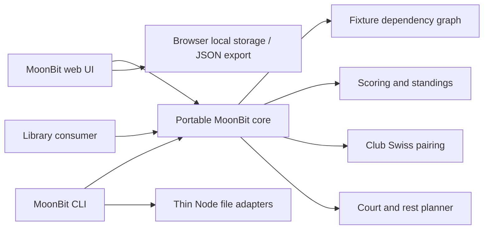

# Architecture and library integration

## Boundaries

The root `moontourney/core` package has no external package dependencies and no filesystem, network or browser access. Domain rules, fixture generation, graph resolution, standings, Swiss pairing, court scheduling, exports and JSON validation are all MoonBit. `webui/` also renders and manages interactions in MoonBit. Its `dom.mbt` contains browser FFI only. `cmd/moontourney/` handles commands in MoonBit and uses small Node file adapters.

## File map

| Module | Responsibility |
|---|---|
| `types.mbt`, `utility.mbt` | Public types, bounded identities, parsing and seed helpers |
| `rules.mbt`, `scoring.mbt` | Named profiles, rule validation, terminal scores, forfeits, independent series |
| `round_robin.mbt`, `brackets.mbt` | Circle schedules, snake groups, seeded upper/lower brackets and slot resolution |
| `standings.mbt` | Exact points, static mini-table metrics, ratios and ranking explanations |
| `swiss.mbt` | Bounded branch-and-bound pairing with no repeats and one bye |
| `tournament.mbt` | State transitions, qualification, withdrawal, invalidation and history |
| `season_series.mbt` | Independent seasonal archives, next-season cloning, historical winners and CSV summaries |
| `scheduling.mbt` | Conservative candidate reservations and independent allocation checks |
| `json_codec.mbt`, `api.mbt` | Schema validation, view projection and failure envelopes |
| `exports.mbt` | Spreadsheet-safe CSV and Markdown reports |

## Dependency graph

A fixture slot is `Seed(id)`, `Winner(fixtureId)`, `Loser(fixtureId)` or `Empty`. Resolution produces `Ready(id)`, `Pending` or `Vacant`. `Pending` differs from an empty bye. Imported graphs must be topological, unique and bounded, referencing known entrants and earlier fixtures only.

`record_result` returns a new tournament. When changing a result, `remove_result` clears all descendants but preserves independent games. Group and combined-league edits remove the generated knockout. Swiss edits remove later rounds because their opponents depended on previous standings. Double-elimination resets are conditional on the grand-final winner.

## Ownership

Tournament operations copy the containers they change. Earlier snapshots remain valid through normal library operations; failed operations return no new snapshot. Public structs expose mutable Array/Map containers for MoonBit ergonomics: **treat returned snapshots and their nested containers as read-only**, and use the transition functions for changes. Direct caller mutation is outside the history contract.

Rules are immutable configuration records. `with_best_of` and `with_seed_tie_break` return normalized profiles with custom-policy disclosure. IDs survive reseeding; initial bracket seed and participant ID are separate.

Season collections hold complete tournament snapshots. Each season can choose its own sport and format; cloning reuses configuration and entrant identities while clearing results and reactivating entrants. Before a result is recorded, `replace_roster` can regenerate the fixtures from a changed entrant list. A collection aggregates only comparable historical counts, namely appearances and titles matched by exact entrant name. It never sums points from unlike rule profiles. Browser storage keeps the active season and collection separately from the legacy single-event key; exporting collection JSON is the portable backup.

## Limits and performance

Most formats support up to 128 entrants; Swiss supports 64. Collections hold at most 32 seasons. JSON inputs are bounded to four million characters, imported fixtures to 20,000 per event, scores to 10,000, best-of lengths to 15 and undo history to 100 steps. Pairing uses a bounded search; full optimality is not promised. Scheduling uses a safe greedy allocation rather than a global optimizer. Graph resolution and standings use straightforward scans suitable for small events, not an unbounded professional event service.

Current JSON tournament imports validate identities, dependencies, results and the declared format structure. They do not certify a fixture graph under a federation's complete regulations. Low-level `validate_fixtures` is available for custom topological graphs. Use `validate_tournament` before processing a manually assembled tournament.

## Distribution

`node scripts/build.mjs` emits `dist/engine.mjs` with `dispatch_json`, a standalone web module and a standalone Node CLI. The browser module contains generated JavaScript from MoonBit; it is ignored by Git. `dist/` can be deployed as static files by a maintainer, but this task does not publish a site or package.
